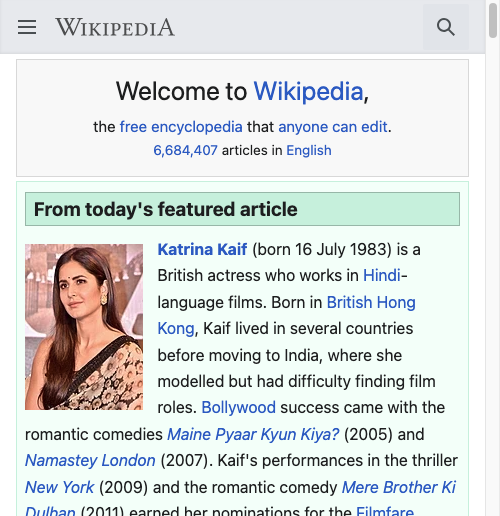

# java-mobile-automation

Кроссплатформенный фреймворк UI-автоматизации тестирования приложения **Wikipedia** для **Android**, **iOS** и **мобильного Web**. Один набор тестовых сценариев, общие абстракции страниц и отдельная реализация PageObject под каждую платформу.


## Что внутри

- **PageObject + PageFactory** — сценарии не знают о локаторах: тест получает нужный объект страницы из фабрики, фабрика выбирает реализацию по платформе.
- **Единый раннер** — JUnit 4, тесты одинаково запускаются на трёх платформах.
- **Отчёты Allure** — шаги, эпики и фичи, отдельное окружение в `environment.properties`.
- **Переключение платформы** — переменная окружения `PLATFORM` (`android`, `ios`, `mobile_web`), без правки кода тестов.
- **CI** — скрипты запуска эмулятора и тестов для Jenkins.

## Стек

| Слой | Технологии |
| --- | --- |
| Язык / сборка | Java 8, Maven |
| Мобильная автоматизация | Appium (Java Client 6.1.0), UiAutomator2, XCUITest |
| Web | Selenium ChromeDriver, мобильный viewport 360×640 |
| Тесты | JUnit 4.12 |
| Отчётность | Allure 2.23.0 (`allure-junit4`, `allure-maven`) |
| Логирование | SLF4J + Log4j |

## Архитектура

```
src/test/java
├── lib
│   ├── Platform.java            # singleton: выбор и создание драйвера по PLATFORM
│   ├── CoreTestCase.java        # базовый тест: драйвер, Allure-env, welcome, MW-URL
│   └── ui
│       ├── *PageObject.java     # общие контракты страниц
│       ├── NavigationUI.java
│       ├── factory              # фабрики: платформа → реализация страницы
│       ├── android              # локаторы и действия Android
│       ├── ios                  # локаторы и действия iOS
│       └── mobile_web           # локаторы и действия мобильного Web
├── tests                        # сценарии
└── suites/TestSuite.java        # весь набор одним запуском
```

Как это работает:

1. `CoreTestCase.setUp()` берёт драйвер у `Platform.getInstance()`.
2. `Platform` читает `PLATFORM` и создаёт `AndroidDriver`, `IOSDriver` или `ChromeDriver` с нужными capabilities.
3. Тест запрашивает страницу через фабрику, например `SearchPageObjectFactory.get(driver)`.
4. Фабрика проверяет платформу и возвращает `AndroidSearchPageObject`, `iOSSearchPageObject` или `MWSearchPageObject` — сценарий остаётся неизменным.
5. `tearDown()` закрывает сессию.

## Покрытие

| Класс | Что проверяет | Android | iOS | Mobile Web |
| --- | --- | :---: | :---: | :---: |
| `SearchTests` | поиск, отмена поиска, пустая и непустая выдача | ✅ | ✅ | ✅ |
| `ArticleTests` | заголовок статьи, свайп до футера | ✅ | ✅ | ✅ |
| `ListsTests` | сохранение статьи в список и удаление из него | ✅ | ✅ | ✅ |
| `HomeWorkTest` | две статьи в списке, удаление первой | ✅ | ✅ | ✅ |
| `ChangeAppConditionTests` | смена ориентации, уход в фон и возврат | ✅ | ✅ | — |
| `GetStartedTest` | прохождение welcome-экрана | — | ✅ | — |

Сценарии со списками на Mobile Web требуют авторизации: логин и пароль тестового аккаунта заданы в тестовых классах.

## Требования

- JDK 8+ и Maven 3.6+
- Appium Server 1.x, доступный на `http://127.0.0.1:4723`
- **Android**: Android SDK, эмулятор `and80` (Android 8.0), APK `apks/org.wikipedia.apk`
- **iOS**: macOS, Xcode и симулятор `iPhone SE (3rd generation)`, iOS 16.4, сборка `apps/Wikipedia.app`
- **Mobile Web**: Chrome и `chromedriver` из корня репозитория
- Allure CLI — по желанию, для просмотра отчёта

## Подготовка

```bash
git clone https://github.com/arslan-ahmetjanov/java-mobile-automation.git
cd java-mobile-automation
mvn -q test-compile
```

Перед первым запуском поправьте `src/test/java/lib/Platform.java`:

- путь к APK в capability `app`;
- путь к `Wikipedia.app`;
- путь к `chromedriver` в `chromedriverExecutable`;
- при необходимости — `deviceName`, `platformVersion`, адрес Appium.

Сейчас там абсолютные пути вида `/Users/arslan/...`, они работают только на машине автора.

Затем поднимите Appium и устройство:

```bash
appium                                   # терминал 1
emulator @and80                          # терминал 2, для Android
# либо откройте симулятор iPhone SE (3rd generation) в Xcode — для iOS
```

## Запуск

Платформа задаётся переменной окружения `PLATFORM`:

```bash
export PLATFORM=android       # macOS / Linux
set PLATFORM=android          # Windows (cmd)
$env:PLATFORM="android"       # Windows (PowerShell)
```

Допустимые значения: `android`, `ios`, `mobile_web`. Если переменная не задана, `Platform` не сможет выбрать драйвер и тест упадёт с сообщением `Cannot detect type of the Driver`.

```bash
# один класс
mvn -Dtest=SearchTests test

# один тест
mvn -Dtest=ArticleTests#testCompareArticleTitle test

# весь набор
mvn -Dtest=TestSuite test
```

Отчёт Allure:

```bash
mvn allure:serve
```

Результаты прогона складываются в `target/allure-results`, HTML-отчёт собирается плагином `allure-maven`.

## CI

| Скрипт | Назначение |
| --- | --- |
| `ci-scripts/runemulator.sh` | запуск эмулятора `@and80` |
| `ci-scripts/runtestsuite.sh` | `PLATFORM=android` и запуск теста через Maven |

Jenkins-job поднимает эмулятор, выставляет `PLATFORM`, запускает Maven и публикует Allure-отчёт. Пути внутри скриптов тоже абсолютные — подставьте свои.

## Скриншоты

| Главный экран | Поиск | Статья |
| --- | --- | --- |
|  |  |  |

## Известные ограничения

- Capabilities и пути к приложениям захардкожены в `Platform.java` — под каждую среду их нужно менять.
- Тесты списков и welcome-экрана зависят от состояния аккаунта и от того, первый ли это запуск приложения.
- `chromedriver` в репозитории может не совпадать с локальной версией Chrome — тогда замените бинарник.

## Курс

Проект сделан как дипломная работа курса [LearnQA Java](https://www.learnqa.ru/java): настройка среды автоматизации с нуля, Android и iOS, мобильный Web, CI на Jenkins и отчётность в Allure.
