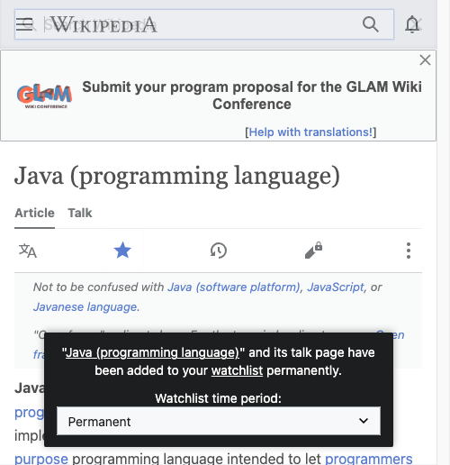
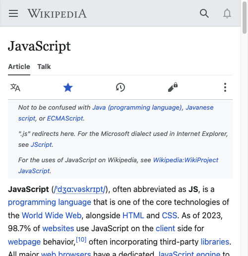

# java-mobile-automation

Кроссплатформенный фреймворк UI-автоматизации тестирования приложения **Wikipedia** для **Android**, **iOS** и **мобильного Web**. Один набор тестовых сценариев, общие абстракции страниц и отдельная реализация PageObject под каждую платформу.


## Что внутри

- **PageObject + фабрики** — сценарии не знают о локаторах: тест получает нужный объект страницы из фабрики, фабрика выбирает реализацию по платформе.
- **Единый раннер** — JUnit 4, тесты одинаково запускаются на трёх платформах.
- **Отчёты Allure** — шаги, эпики и фичи, отдельное окружение в `environment.properties`, скриншот упавшего теста вложением.
- **Конфигурация без правки кода** — `lib/Config`: `-Dkey=value` → переменная окружения → `config.properties` → значение по умолчанию. Платформа, пути к приложениям, адрес Appium и доступы задаются снаружи.
- **CI** — скрипты запуска эмулятора и всего набора тестов для Jenkins.

## Стек

| Слой | Технологии |
| --- | --- |
| Язык / сборка | Java 8, Maven |
| Мобильная автоматизация | Appium (Java Client 6.1.0), UiAutomator2, XCUITest |
| Web | Selenium ChromeDriver, мобильный viewport 360×640 |
| Тесты | JUnit 4.12 |
| Отчётность | Allure 2.23.0 (`allure-junit4`, `allure-maven`) |
| Логирование | SLF4J + `slf4j-simple` |

## Архитектура

```
src/test/java
├── lib
│   ├── Config.java              # настройки: -D → env → config.properties → default
│   ├── Platform.java            # singleton: выбор и создание драйвера по платформе
│   ├── CoreTestCase.java        # базовый тест: драйвер, Allure-env, welcome, MW-URL
│   └── ui
│       ├── *PageObject.java     # общие контракты страниц
│       ├── NavigationUI.java
│       ├── factory              # фабрики: платформа → реализация страницы
│       ├── android              # локаторы и действия Android
│       ├── ios                  # локаторы и действия iOS
│       └── mobile_web           # локаторы и действия мобильного Web
├── tests                        # сценарии
├── suites/TestSuite.java        # весь набор одним запуском
└── resources
    ├── config.properties        # значения по умолчанию, без секретов
    └── simplelogger.properties  # уровни логирования
```

Как это работает:

1. `CoreTestCase.setUp()` берёт драйвер у `Platform.getInstance()`.
2. `Platform` читает значение `platform` через `Config` и создаёт `AndroidDriver`, `IOSDriver` или `ChromeDriver` с capabilities из конфигурации. Неизвестная платформа — сразу `IllegalArgumentException` со списком допустимых значений.
3. Тест запрашивает страницу через фабрику, например `SearchPageObjectFactory.get(driver)`.
4. Фабрика проверяет платформу и возвращает `AndroidSearchPageObject`, `iOSSearchPageObject` или `MWSearchPageObject` — сценарий остаётся неизменным.
5. `TestWatcher` снимает скриншот упавшего теста до закрытия сессии, затем `tearDown()` закрывает драйвер (безопасно, если сессия не создалась).

## Покрытие

| Класс | Что проверяет | Android | iOS | Mobile Web |
| --- | --- | :---: | :---: | :---: |
| `SearchTests` | поиск, отмена поиска, пустая и непустая выдача | ✅ | ✅ | ✅ |
| `ArticleTests` | заголовок статьи, свайп до футера | ✅ | ✅ | ✅ |
| `ListsTests` | сохранение статьи в список и удаление из него | ✅ | ✅ | ✅ |
| `HomeWorkTest` | две статьи в списке, удаление первой | ✅ | ✅ | ✅ |
| `ChangeAppConditionTests` | смена ориентации, уход в фон и возврат | ✅ | ✅ | skipped |
| `GetStartedTest` | прохождение welcome-экрана | skipped | ✅ | skipped |

Сценарии со списками на Mobile Web требуют авторизации. Логин и пароль берутся из `wiki.user`/`wiki.password`; если они не заданы, тесты помечаются как skipped, а не падают. Неподдерживаемые платформы тоже отмечаются через `Assume` — в отчёте честный skipped.

## Требования

- JDK 8+ и Maven 3.6+
- Appium Server 1.x, доступный на `http://127.0.0.1:4723/wd/hub`
- **Android**: Android SDK, эмулятор `and80` (Android 8.0), APK из `android.app`
- **iOS**: macOS, Xcode и симулятор `iPhone SE (3rd generation)`, iOS 16.4, сборка из `ios.app`
- **Mobile Web**: Chrome и бинарник `chromedriver` по пути из `chrome.driver`
- Allure CLI — по желанию, для просмотра отчёта

## Конфигурация

Все значения читает `lib/Config`. Приоритет: системное свойство (`-Dkey=value`) → переменная окружения (`UPPER_SNAKE` от ключа) → `src/test/resources/config.properties` → значение по умолчанию. Относительные пути разрешаются от каталога запуска (`user.dir`), поэтому проект работает из любой папки.

| Ключ | Переменная окружения | По умолчанию | Назначение |
| --- | --- | --- | --- |
| `platform` | `PLATFORM` | `android` | `android`, `ios` или `mobile_web` |
| `appium.url` | `APPIUM_URL` | `http://127.0.0.1:4723/wd/hub` | адрес Appium Server |
| `android.device` | `ANDROID_DEVICE` | `AndroidTestDevice` | имя устройства/эмулятора |
| `android.version` | `ANDROID_VERSION` | `8.0` | версия Android |
| `android.app` | `ANDROID_APP` | `apks/org.wikipedia.apk` | путь к APK |
| `ios.device` | `IOS_DEVICE` | `iPhone SE (3rd generation)` | имя симулятора |
| `ios.version` | `IOS_VERSION` | `16.4` | версия iOS |
| `ios.app` | `IOS_APP` | `apps/Wikipedia.app` | путь к сборке приложения |
| `chrome.driver` | `CHROME_DRIVER` | `chromedriver` | путь к chromedriver |
| `wiki.url` | `WIKI_URL` | `https://en.m.wikipedia.org` | стартовый URL мобильного Web |
| `wiki.user` | `WIKI_USER` | пусто | логин тестового аккаунта |
| `wiki.password` | `WIKI_PASSWORD` | пусто | пароль тестового аккаунта |
| `timeout.default` | `TIMEOUT_DEFAULT` | `15` | таймаут ожиданий, секунды |
| `reset.app` | `RESET_APP` | `false` | `fullReset` для Appium и пропуск welcome-экрана в `setUp` |

### Секреты

Пароль в репозитории не хранится и в `config.properties` должен оставаться пустым. Для прогонов передавайте доступы снаружи:

```bash
export WIKI_USER='user@tests'
export WIKI_PASSWORD='...'
```

В Jenkins — через Credentials и `withCredentials`, а не в тексте джобы. Для Викимедиа правильнее не пароль аккаунта, а bot password из `Special:BotPasswords`: он отзывается одной кнопкой и не даёт доступа к основному аккаунту.

## Подготовка

```bash
git clone https://github.com/arslan-ahmetjanov/java-mobile-automation.git
cd java-mobile-automation
mvn -q test-compile
```

Правки кода не нужны: если APK, приложение или chromedriver лежат в других местах, задайте пути через `-D` или `config.properties`.

Затем поднимите Appium и устройство:

```bash
appium                                   # терминал 1
emulator @and80                          # терминал 2, для Android
# либо откройте симулятор iPhone SE (3rd generation) в Xcode — для iOS
```

## Запуск

Платформа задаётся ключом `platform` (по умолчанию `android`):

```bash
# через Maven
mvn -Dplatform=mobile_web -Dtest=SearchTests test

# либо переменной окружения
export PLATFORM=mobile_web      # macOS / Linux
set PLATFORM=mobile_web         # Windows (cmd)
$env:PLATFORM="mobile_web"      # Windows (PowerShell)
```

```bash
# один класс
mvn -Dtest=SearchTests test

# один тест
mvn -Dtest=ArticleTests#testCompareArticleTitle test

# весь набор
mvn -Dtest=TestSuite test

# чистый стейт приложения (welcome-экран и первый запуск)
mvn -Dplatform=ios -Dreset.app=true -Dtest=GetStartedTest test
```

Отчёт Allure:

```bash
mvn allure:serve
```

Результаты прогона складываются в `target/allure-results`, HTML-отчёт собирается плагином `allure-maven`. Скриншоты складываются в `target/screenshots` и не засоряют рабочее дерево.

## CI

| Скрипт | Назначение |
| --- | --- |
| `ci-scripts/runemulator.sh` | запуск эмулятора `@and80` |
| `ci-scripts/runtestsuite.sh` | `PLATFORM=android` (если не задан) и прогон всего `suites.TestSuite` |

Скрипты запускаются из своего каталога (`set -euo pipefail`, путь от `BASH_SOURCE`), абсолютных путей к домашнему каталогу в них нет. Jenkins-job поднимает эмулятор, выставляет `PLATFORM`, прогоняет Maven и публикует Allure-отчёт из `target/allure-results`.

## Скриншоты

| Главный экран | Поиск | Статья |
| --- | --- | --- |
|  |  |  |

## Известные ограничения

- Локаторы и тексты привязаны к английской локали и конкретной версии приложения Wikipedia; при обновлении приложения их придётся править.
- Тесты списков меняют состояние тестового аккаунта: ожидается, что статьи из сценария не добавлены в watchlist заранее.
- `GetStartedTest` требует чистого состояния приложения — запускайте его с `-Dreset.app=true`.
- `chromedriver` в репозитории может не совпадать с локальной версией Chrome — тогда укажите другой бинарник в `chrome.driver`.
- Бинарники (APK, сборка iOS, chromedriver) лежат в репозитории: клонирование тяжёлое, при необходимости их стоит вынести в LFS или скачивание в CI.

## Курс

Проект сделан как дипломная работа курса [LearnQA Java](https://www.learnqa.ru/java): настройка среды автоматизации с нуля, Android и iOS, мобильный Web, CI на Jenkins и отчётность в Allure.
